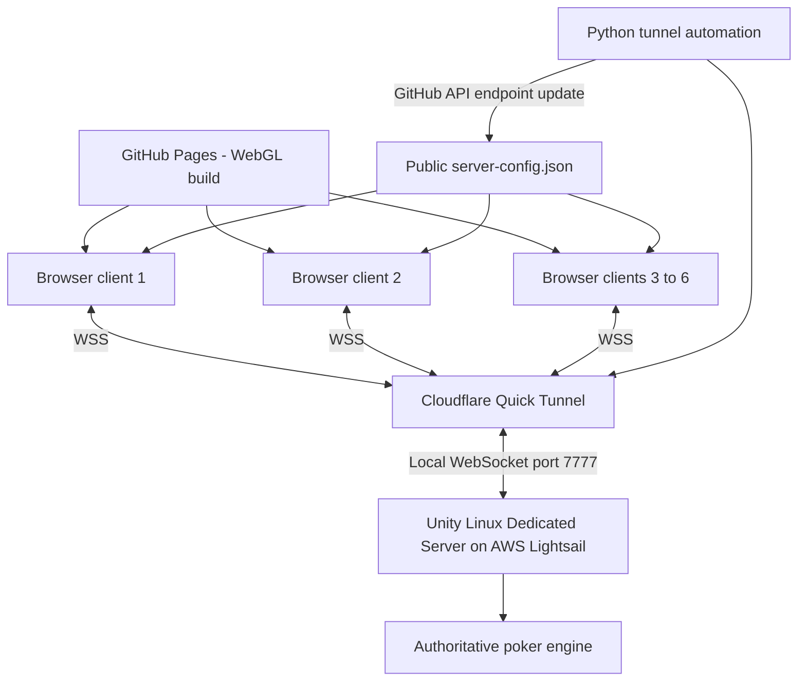

# Multiplayer Poker — Texas Hold'em

A server-authoritative multiplayer Texas Hold'em prototype developed in Unity as part of a Game Developer technical assignment. The project focuses on poker rule implementation, real-time multiplayer synchronization, secure handling of private cards, betting validation and a playable browser-based experience.

The game uses virtual chips exclusively. There are no deposits, withdrawals, real-money wagers, in-app purchases or loot boxes.

## 1. Play the game

- **WebGL build:** https://dineshsamson.github.io/MultiplayerPoker/
- **Source code:** https://github.com/DineshSamson/MultiplayerPoker
- **Target platform:** Desktop web browsers, landscape layout. Mobile browser compatibility may vary.
- **Players:** 2–6 per table.
- **Starting balance:** 1,000 virtual chips per player.

The evaluation build uses a temporary cloud-hosted dedicated server. No Unity installation or local server setup is required to play the hosted build. Availability depends on the evaluation server and tunnel remaining operational.

### How to test multiplayer

1. Open the WebGL link in a modern desktop browser.
2. Use the connection menu to join the table.
3. Open the same link on another device or in a separate browser/incognito window and join as another player.
4. Once at least two eligible players are connected, the first-hand countdown begins. Additional players can join up to the table capacity.
5. Observe the private cards, dealer and blind indicators, chip balances, pot and active turn on both clients.
6. Play through Pre-flop, Flop, Turn and River to Showdown using the available betting actions. A hand may also finish early if all but one player fold.
7. Verify that the winner, pot settlement and chip balances agree across clients.
8. Start the next hand using the available next-hand control.

For a three-player test, repeat the connection process on a third device or browser session before the first hand starts. Players joining during a hand wait for the next eligible hand.

If the browser has cached an older deployment, perform a hard refresh (Ctrl+F5). Audio playback may require an initial user interaction due to browser autoplay restrictions.

## 2. Technology stack

| Technology | Purpose |
| --- | --- |
| Unity 6 (6000.0.83f1) | Game engine |
| C# | Poker rules, networking and presentation |
| Netcode for GameObjects 2.14.0 | Client/server replication and RPCs |
| Unity Transport 2.7.4 | Network transport |
| WebGL | Browser client |
| WebSocket / WSS | Browser-compatible network connection |
| Linux Dedicated Server (x86_64) | Headless authoritative game server |
| AWS Lightsail, Ubuntu 24.04 | Temporary cloud hosting |
| Cloudflare Quick Tunnel | Public encrypted WebSocket endpoint |
| GitHub Pages | Static WebGL hosting |
| Python and GitHub API | Automatic tunnel endpoint updates |
| systemd | Server and tunnel process management |
| TextMeshPro / Unity UI | Game interface |
| PlayerPrefs | Local music and reminder preferences |

## 3. System architecture



The WebGL build and game server are deployed independently. GitHub Pages serves static client files; it does not execute the poker server. The Linux dedicated server runs on AWS independently of the developer's computer.

### Server responsibilities

- Shuffle the deck, deal cards and maintain authoritative hand state.
- Assign seats, rotate the dealer and post blinds.
- Validate player identity, turn, hand sequence and betting actions.
- Manage betting rounds, turn deadlines and automatic timeout actions.
- Evaluate hands, calculate main and side pots and distribute virtual chips.
- Synchronize public game state and deliver private cards only to the relevant client.

### Client responsibilities

- Connect to the dedicated server and display replicated game state.
- Present the local player's cards, public cards, bets, balances and turn indicators.
- Submit player action requests rather than calculated outcomes.
- Display card animations, sound effects, contextual guidance and session statistics.

The server is the source of truth. Client-side button restrictions improve usability but are not relied upon as the sole enforcement of poker rules.

## 4. Gameplay and implemented features

### Multiplayer

- A single shared table supporting up to six players across different devices.
- Real-time synchronization of seats, bets, chip balances, pot, hand stage and turn state.
- Late-joining players wait for the next hand rather than interrupting an active hand.
- Disconnected players are handled by the server; eligible disconnected players fold while committed chips remain accounted for.
- A 30-second server-controlled turn timer automatically checks when legal, otherwise folds.
- Betting is disabled during the initial dealing interval; the first turn begins after that interval.

### Texas Hold'em rules

- Two private cards per participating player and up to five community cards.
- Dealer button, small blind and big blind with rotation between hands.
- Pre-flop, Flop, Turn, River and Showdown stages.
- Fold, Check, Call, Raise and All-in actions.
- Best five-card hand evaluation from seven available cards, including standard rankings from high card to straight flush (including royal flush).
- Main pot and side-pot calculation for unequal all-in contributions.
- Split-pot handling for tied winning hands and chip conservation checks.
- Early settlement when only one non-folded player remains.

### Betting system

- Minimum opening bet based on the big blind.
- Minimum raise based on the previous full raise, with server-side validation of betting limits and raise eligibility.
- Half-pot and full-pot quick-raise controls, plus custom raise amounts.
- Quick-raise controls populate the raise amount; the Raise action submits the request.
- Raise amounts represent the total bet for the current round (raise-to), not simply the additional chips.
- A call commits only the available chips when the player cannot cover the full amount, resulting in an all-in.
- Invalid, out-of-turn and stale action requests are rejected by the server.

### User interface and presentation

- Landscape poker table with dynamic seat positioning relative to the local player.
- Private and community cards, player chip balances, current bets, pot and last actions.
- Dealer, small blind and big blind indicators.
- Active-turn highlighting and circular countdown indicator.
- Context-sensitive betting controls and beginner-friendly guidance.
- Help panel, waiting/countdown display and showdown result display.
- Card dealing and flipping animations.
- Background music, button sounds, timer warning sounds and break notification audio.
- Music on/off control with locally saved preference.

### Responsible design

The only player-retention feature is a session-based hands-played statistic (counted when the player participates in a dealt hand). No time-based rewards, pressure counters, purchase prompts or engagement streaks are included.

A configurable long-session break reminder is provided, designed for a 30-minute interval, with a dismiss option and an opt-out preference. The reminder does not pause the shared multiplayer game. The turn timer is a gameplay rule, not an engagement reward mechanism.

## 5. Code organization

The implementation separates poker rules from networking and presentation. Key scripts include:

| Layer | Scripts | Responsibility |
| --- | --- | --- |
| Core rules | `PokerGameEngine`, `BettingManager` | Hand lifecycle, betting rounds and action validation |
| Evaluation | `HandEvaluator`, `SidePotCalculator` | Hand ranking and pot settlement |
| Networking | `PokerTableManager`, `PokerPlayerData` | Authoritative game coordination and replicated player state |
| Connection | `NetworkTestUI`, `DedicatedServerBootstrap` | Client connection and automatic dedicated server startup |
| UI | `PokerCanvasUI`, `PokerSeatUI`, `PokerRelativeSeatLayout` | Table presentation and player controls |
| Turn and blinds | `PokerTurnTimerUI`, `PokerBlindIndicatorsUI` | Turn deadline and dealer/blind indicators |
| Cards | `PokerCardUI`, `PokerSeatCardsUI`, `PokerCardDealAnimator` | Card presentation and animations |
| Session and audio | `PokerSessionUI`, `PokerAudioUI`, `PokerMusicButton`, `PokerBreakPopup` | Session statistics, reminders and audio controls |

The poker engine is separated from the visual interface so rule behavior can be tested independently of card animations and UI interaction.

## 6. Hosting and deployment design

### AWS Lightsail dedicated server

The Unity project is built using the Linux Server build profile for x86_64. The dedicated server starts automatically through `DedicatedServerBootstrap` and runs without a graphical interface using `-batchmode -nographics`.

The evaluation instance uses Ubuntu 24.04 and the poker service listens on local port 7777. The public browser connection is routed through Cloudflare rather than requiring a publicly exposed Unity transport port.

### Cloudflare Quick Tunnel

WebGL clients require a browser-compatible WebSocket connection. Cloudflare Quick Tunnel provides a public WSS endpoint forwarding traffic to the local Unity server.

Quick Tunnel URLs are temporary and can change when the tunnel restarts. To avoid rebuilding the WebGL client whenever the endpoint changes, the project uses a remote configuration file at the repository root:

```json
{
  "serverUrl": "wss://example.trycloudflare.com",
  "port": 443
}
```

The URL above is illustrative. The actual endpoint is maintained in `server-config.json` by the deployment automation. The browser client retrieves this configuration when connecting.

### Automatic endpoint updates

A Python tunnel-management process runs on the AWS instance. It launches the Cloudflare tunnel, detects the generated public endpoint and updates `server-config.json` using the GitHub API. This allows the same GitHub Pages URL to remain usable when the tunnel endpoint changes, subject to service availability and configuration propagation.

The GitHub API credential is stored separately on the server, not in the public client configuration. SSH keys and cloud credentials must not be committed to the repository.

### Process management

Two systemd services manage the deployment:

| Service | Purpose |
| --- | --- |
| `poker-server.service` | Runs the Unity Linux dedicated server |
| `poker-tunnel.service` | Runs the Python tunnel manager and endpoint update process |

The services are configured to start on boot and restart after unexpected process termination. Restarting the game server resets its in-memory game state. Restarting the tunnel can interrupt active connections and generate a new endpoint.

For deployment maintenance, the following commands are run on the Linux host:

```bash
systemctl is-active poker-server poker-tunnel
sudo ss -ltnp | grep ':7777'
sudo journalctl -u poker-server -n 30 --no-pager
sudo journalctl -u poker-tunnel -n 30 --no-pager
```

### GitHub Pages client

The generated WebGL build is hosted from the `docs/` directory on the `main` branch. Gzip compression with decompression fallback is used for static hosting compatibility. The client and server should always be built from the same project revision to avoid incompatible network serialization.

The hosting arrangement was selected to minimize assignment infrastructure costs and allow remote evaluation without keeping a personal computer running. Cloud hosting credits, temporary tunnel availability and API credential validity are not permanent service guarantees.

## 7. Running the source project locally

### Prerequisites

- Unity Hub and Unity Editor 6000.0.83f1.
- Windows Build Support for local Windows client testing.
- Linux Dedicated Server Build Support for Linux server builds.
- WebGL Build Support for browser builds.

### Local multiplayer testing

1. Clone the repository:

   ```bash
   git clone https://github.com/DineshSamson/MultiplayerPoker.git
   ```

2. Open the cloned project through Unity Hub and allow package import to complete.
3. Open `Assets/Scenes/PokerGame.unity`.
4. Select the Windows build profile and build a standalone client outside the project folder.
5. Enter Play Mode in the Unity Editor and use the existing server-start control.
6. Launch two or more instances of the Windows executable and use the client connection control. For same-machine testing, use the existing local transport configuration (loopback address and port 7777).
7. Play a complete hand and compare synchronized results across clients.

### Building the dedicated server

1. Open File > Build Profiles and select Linux Server, x86_64.
2. Ensure the poker scene is included and Development Build is disabled.
3. Build the executable as `PokerServer` and retain the generated data folder and runtime libraries.
4. Transfer the complete build to a compatible Linux host and make the executable runnable:

   ```bash
   chmod +x PokerServer.x86_64
   ./PokerServer.x86_64 -batchmode -nographics -logFile -
   ```

5. Verify successful startup and that the configured transport port is listening. For public WebGL connectivity, configure a compatible WSS endpoint and update the remote client configuration.

### Building the WebGL client

1. Switch to the WebGL build profile in Unity.
2. Keep Development Build disabled and use Gzip compression with decompression fallback for GitHub Pages.
3. Build to an empty output directory.
4. Deploy the generated `index.html`, `Build/` and `TemplateData/` files to the static host. For this repository, the deployment directory is `docs/`.
5. Preserve the repository-root `server-config.json` and ensure it points to the running server endpoint.

## 8. Testing performed

During development, the poker engine test suite reported **11 passed, 0 failed**. This result was recorded before the final presentation and audio changes; it is not a claim of exhaustive rule coverage or a fresh final-build test run.

Development testing included:

- Betting action and round progression tests.
- Split-pot and pot settlement tests, including chip conservation.
- Local multiplayer testing using multiple Windows clients and an Editor server.
- Verification of synchronized private/public card presentation, pot and chip balances.
- Complete hand progression, folding, winner settlement and subsequent hands.
- Six-player betting regression testing.
- Half-pot/full-pot raise calculations and turn timeout behavior.
- Late joining, break reminder behavior and opt-out controls.
- Remote WebGL connectivity through the cloud server, including a mobile-data connection during development.

The final Linux server and WebGL client were built from the final project. Final public deployment and cross-device smoke testing should be verified before evaluation; the development tests above do not constitute a production security or load test.

## 9. Assignment requirement coverage

| Requirement | Implementation status |
| --- | --- |
| Texas Hold'em, 2–6 players, 1,000 virtual chips | Implemented |
| Real-time remote multiplayer | Implemented and tested during development |
| Create/select tables by code or list | Partial: direct connection to one shared table only |
| Server-authoritative dealing, betting and winner evaluation | Implemented |
| Private card isolation | Implemented through targeted delivery; not independently security-audited |
| Turn timer and automatic check/fold | Implemented and tested |
| Mid-hand joining and leaving | Implemented with reconnection limitations |
| Dealer, blinds, stages and betting actions | Implemented |
| Hand evaluation, tied hands and side pots | Implemented; pot settlement tests performed |
| Odd-chip allocation relative to dealer | Split-pot handling implemented; exact odd-chip ordering not independently verified in final build |
| Clear UI and contextual guidance | Implemented |
| Quick raises, custom raises and short-stack calls | Implemented |
| Computer opponents | Omitted due to time constraints |
| Out-of-chips handling and chip reset | Partial: zero-chip players cannot continue betting; dedicated spectator/rebuy flow not confirmed |
| Disconnect timeout and state-preserving reconnection | Partial: immediate fold when applicable; previous session is not restored |
| Server disconnection handling | Connection status UI provided; final server-loss scenario not independently verified |
| Invalid client action rejection | Implemented; exhaustive adversarial testing not performed |
| Session statistics and opt-out break reminder | Implemented |
| Sound effects and card animations | Implemented (optional extras) |
| Automated poker engine and pot tests | Performed (optional extra) |
| In-table text chat | Omitted (optional extra) |

## 10. Known limitations and future improvements

This project was scoped as a working prototype for the approximately three-to-four-day assignment window. The following limitations are intentionally documented rather than presented as completed features.

1. **Single shared table:** Multi-table creation, room codes and table-list selection are not implemented. All connected players join the same table, subject to capacity.
2. **Reconnection:** A disconnected player folds immediately when applicable, rather than after a reconnection grace period. All-in players remain eligible for the relevant pot. A reconnecting player is treated as a new participant with a fresh 1,000-chip balance, subject to seat availability. Previous seat, chip balance and private cards are not restored.
3. **Bankrupt players:** Players without chips cannot participate in betting. A dedicated spectator-mode interface and in-table restart-with-1,000-chips workflow are not confirmed as implemented.
4. **Server restart and virtual wagers:** The game state is stored in server memory. If the server stops or crashes, the current hand, pot contributions and session balances can be lost. There is no durable transaction recovery or database-backed session restoration. These are virtual chips only and have no monetary value.
5. **Odd chips:** Split-pot behavior was tested, but exact dealer-relative odd-chip allocation should receive an additional targeted regression test.
6. **Temporary hosting:** Quick Tunnel endpoints may change, connections may be interrupted, and configuration updates may take time to propagate. The evaluation server is not intended as a production service with guaranteed uptime.
7. **Public access:** The public connection endpoint allows anonymous clients to attempt connections. Server-side rule validation is implemented, but production authentication, abuse prevention, rate limiting and comprehensive security testing are outside this prototype's scope.
8. **Platform coverage:** Desktop landscape browsers are the primary target. Mobile layouts, browser-specific behavior and forced orientation are not comprehensively validated.
9. **Optional features:** Bots, bot difficulty levels and in-table text chat were excluded to prioritize the core multiplayer and poker systems.

Future work would prioritize stable player identities, reconnect grace periods, state restoration, the spectator/chip-reset flow, isolated multi-table sessions, additional edge-case regression tests and production hosting/security improvements.

## 11. Design rationale

- **Server authority:** Centralizes poker rules and prevents clients from directly deciding cards, winners or chip settlement.
- **Separate engine and presentation:** Makes poker behavior easier to test and maintain without depending on UI animation timing.
- **Dedicated Linux server:** Allows independent remote multiplayer evaluation without relying on a developer-hosted client.
- **Remote endpoint configuration:** Avoids rebuilding the WebGL client whenever a temporary tunnel URL changes.
- **Single-table scope:** Prioritizes a playable end-to-end system within the assignment time constraint, while leaving room management as future work.
- **Responsible gameplay:** Uses virtual chips only and includes an optional break reminder without purchase or engagement-pressure mechanics.

---

Developed by **Dinesh Samson** for the Multiplayer Poker Sample — Game Developer technical assignment.
